<div align="center">


# Adigam AI

### Your course material, turned into a tutor that cites its sources and a study plan that adapts to you.

**Multimodal AI Hackathon 2026 · Track D — Personalized Tutoring & Adaptive Learning**

[](server)
[](frontend)
[](database)
[](server/internal/jobs)
[](server/internal/ai)
[](#-testing--what-was-verified)
[](#-scale--load-tests)

<br/>

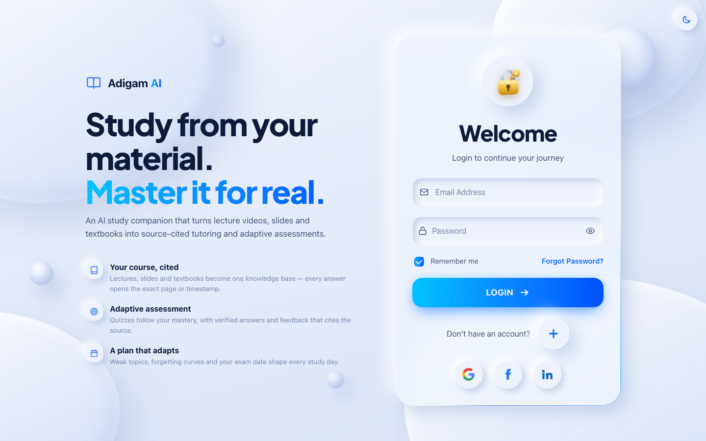
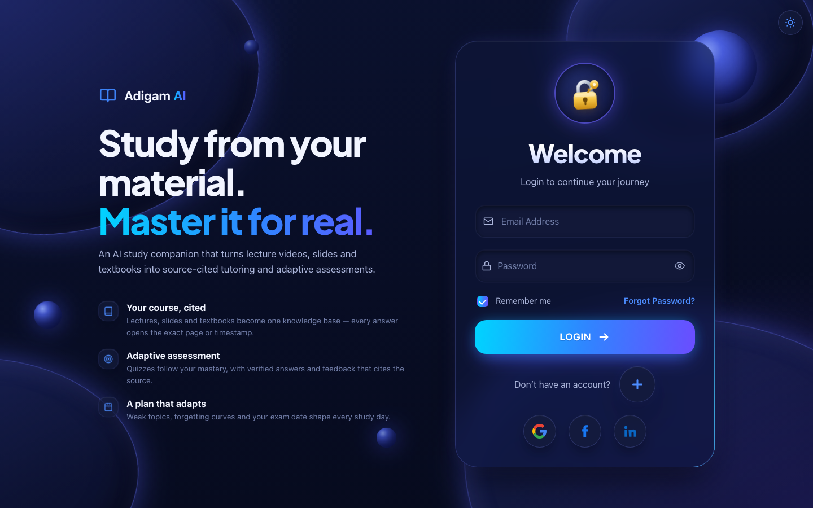

</div>

---

## ✨ What it does

Students study from lecture videos, slides and textbooks scattered across places, and general chatbots
answer without tying anything to the course or to what the student already knows. Adigam fixes both:

| | |
|---|---|
| 📚 **One knowledge base from your material** | Upload PDFs and slide decks, paste a lecture video link. Text, slide images, figures and transcripts become excerpts that remember their **page, slide or timestamp**. |
| 🗺️ **A course map** | Topics, key concepts and prerequisites are identified from the material, and every excerpt is tagged to a topic. |
| 💬 **A tutor that cites, or says it can't** | Answers quote numbered excerpts; one tap opens the exact page, slide or second of video. Anything the material doesn't cover is declined or clearly labelled as outside knowledge. Explains in Hindi/Hinglish too. |
| 🎯 **Adaptive assessment** | Diagnostic, practice and mock exams. Every generated question is checked by a **second, independent solve** before a learner sees it, and repeats are avoided. |
| 📈 **A learner model you can read** | Per-topic mastery from the evidence (recent vs historical accuracy, difficulty, consistency, decay), SM-2 spaced repetition, and an exam-readiness score that shows its working. |
| 🗓️ **A plan that adapts** | Day-by-day sessions weighted to weak topics, forgetting curves and the exam date — rebuilt automatically when you fall behind. |
| 🎙️ **Voice** | Ask by voice, hear answers read aloud. |

---

## 🖼️ Screens

Day mode (soft 3D) and night mode (neon glass) — the same design on a phone and a laptop.

<table>
<tr>
<td width="50%">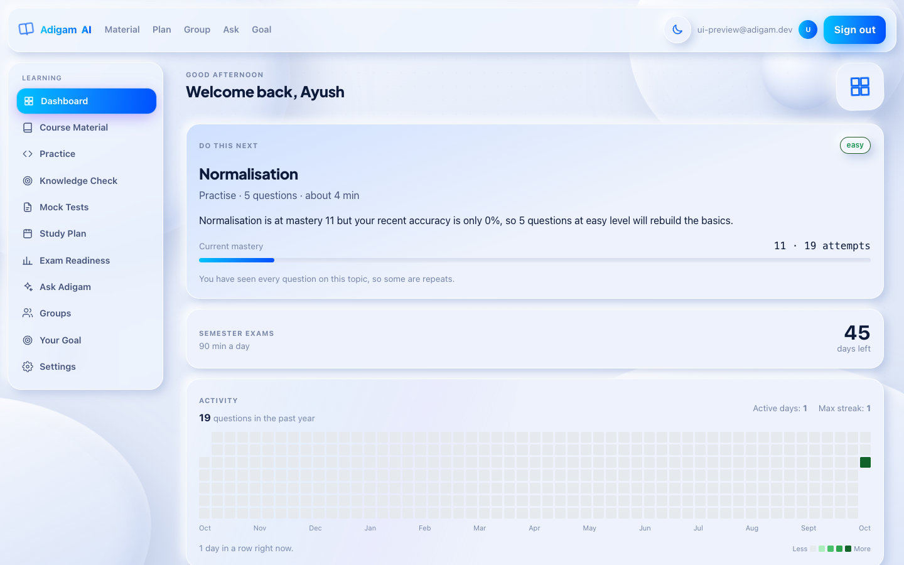</td>
<td width="50%">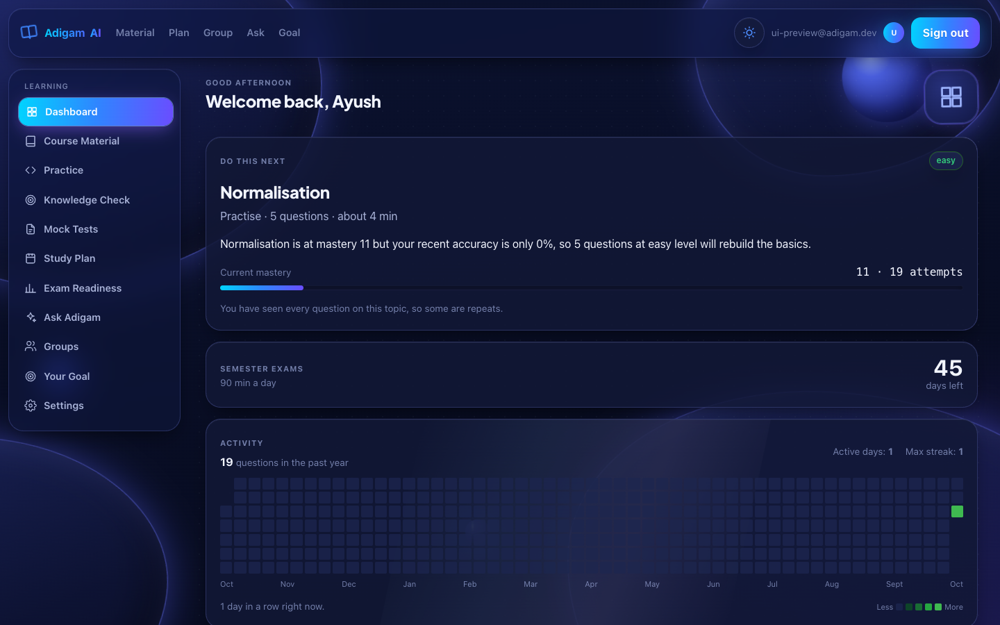</td>
</tr>
<tr>
<td>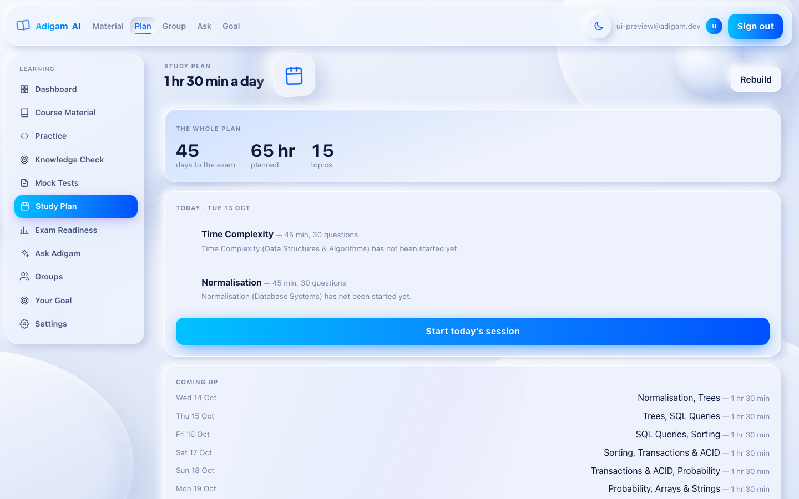</td>
<td>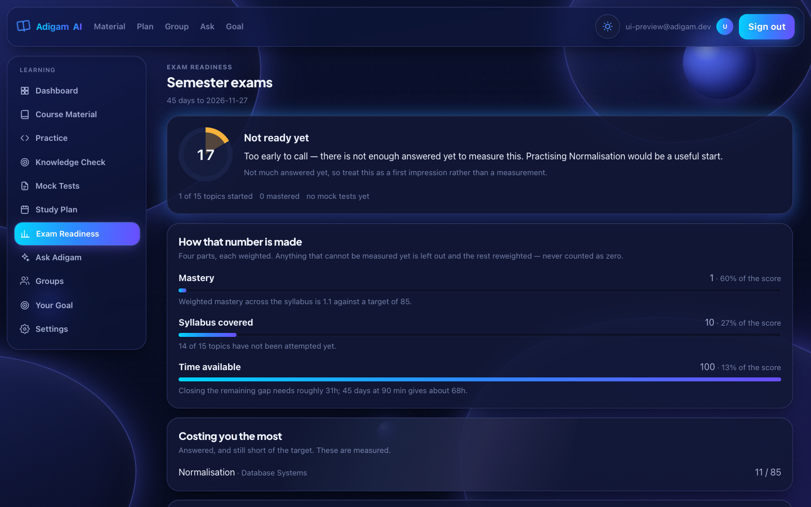</td>
</tr>
<tr>
<td>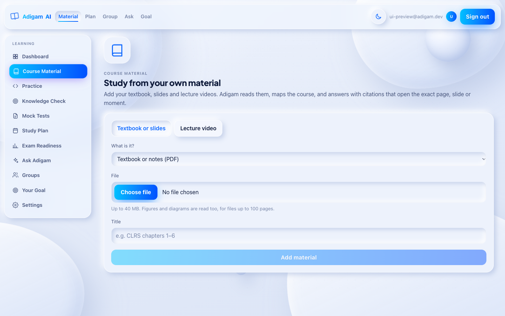</td>
<td>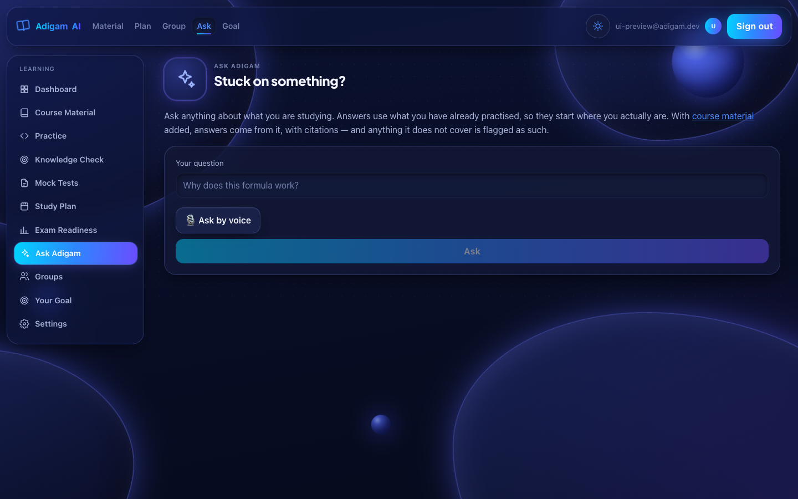</td>
</tr>
</table>

<div align="center">
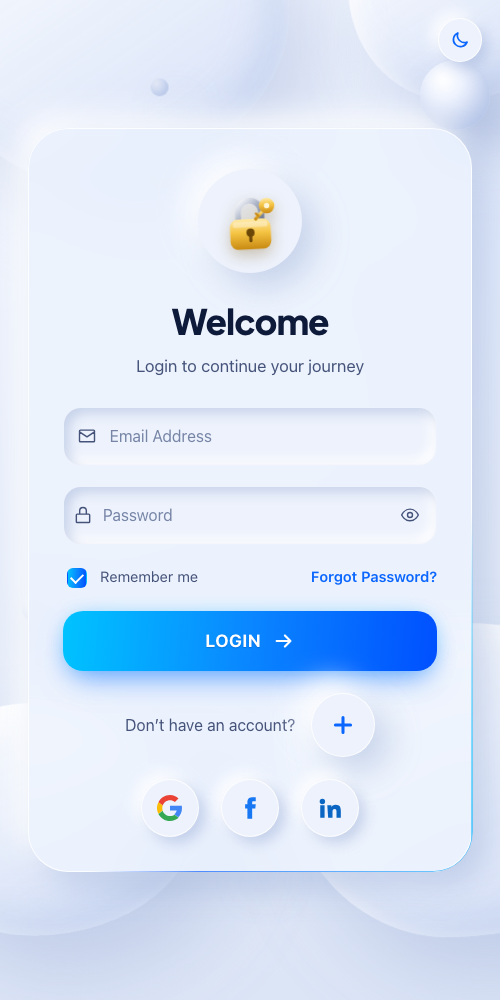

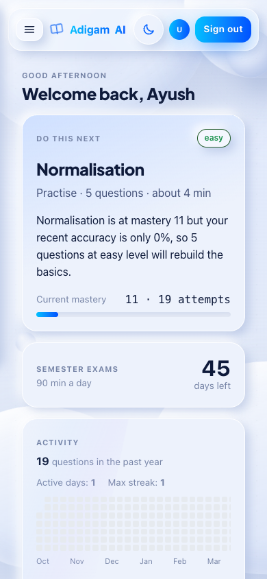
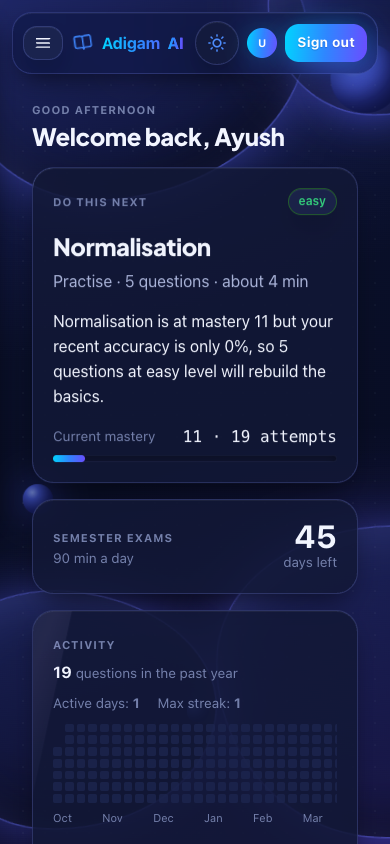
</div>

**Motion, kept smooth:** morphing 3D blobs and floating spheres that lean with the pointer or the phone's
tilt, a light line that runs round the focused field, press-and-ripple feedback on every control, staggered
page entrances. Everything animates `transform`/`opacity` only (compositor, full frame rate), and all of it
switches off under the OS "reduce motion" setting.

---

## 🧭 Track D requirements → where they live

| # | Requirement | Status | How |
|---|---|---|---|
| 1a | Ingest videos, textbooks, slides without preprocessing | ✅ | PDF (pure-Go extraction), PPTX (text + slide images), YouTube transcripts or uploaded `.vtt/.srt` — `server/internal/sources` |
| 1b | Units linked to origin | ✅ | Every excerpt stores page / slide / start–end second; a DB check makes one mandatory |
| 1c | Topics, subtopics, concepts; every unit tagged | ✅ | Course map from the material (topics, key concepts, prerequisites) — `web/content/coursemap.go` |
| 1d | Information from figures and diagrams | ✅ | Claude vision describes PDF figures and slide images; stored as `figure` excerpts |
| 2a | Cited answers opening the exact location | ✅ | Citation chips open PDF at `#page=N`, YouTube at `&t=Ns`, slides show their slide number |
| 2b | Decline / flag off-material queries | ✅ | `ai.CheckGrounding`: uncited answers become "not covered"; outside knowledge is labelled |
| 3a | Quizzes and mock exams, tagged | ✅ | MCQ, multi-select, numerical and **short answer** (rubric-graded server-side); mock tests on learner-chosen topics; every question carries topic, difficulty and source excerpt |
| 3b | Verify correctness, avoid repeats | ✅ | Independent re-solve must agree before `is_verified`; selector prefers unseen, then oldest-seen |
| 3c | Cited feedback + post-assessment report | ✅ | Per-question review with the source to revisit; weak-topic report; **misconceptions** from each wrong option's label and the short-answer grader, tracked per learner |
| 4a | Mastery updated after every quiz and conversation | ✅ | Evidence-based mastery + SM-2 after every practice answer, paper and **tutor quick-check** |
| 4b | New students | ✅ | **Onboarding**: intake (course, exam date, language, self-rated confidence as a mastery prior) → upload → automatic course map → diagnostic → plan |
| 5a/b | RAGAS evaluation on a team-built test set | ✅ | 36 questions on MIT 6.006 lectures 1–3 (PDF notes + lecture videos) — [results below](#-grounding--ragas-5ab) |
| 5c | Simulated students across sessions | ✅ | 4 learner profiles × 10 sessions × 5 seeds — [results below](#-simulated-students-5c) |
| 6b | Revision material for weak topics | ✅ flashcards | Cited flashcards for due and weak topics, reviewed with SM-2. *Audio briefs: planned* |
| 6a | Course flow map | ✅ list view | Topics with "needs first" prerequisites. *Graph view: planned* |
| 6c | Study schedule from weak topics, forgetting curves, exam date | ✅ | `internal/planning` + `internal/learner/srs.go` |
| 6d | English lectures, Hindi explanations | ✅ | Tutor replies in the learner's language; Hindi/Hinglish questions are translated before retrieval |
| 6e | Audio tutoring | ✅ | Voice in (speech recognition), voice out (speech synthesis) |

---

## 🏗️ Architecture

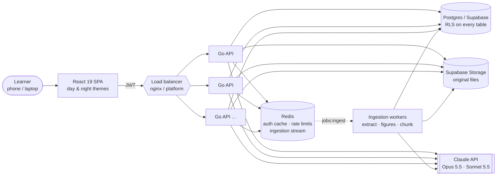

**Design rules the code follows**

- **Arithmetic where arithmetic works, a model where language is needed.** Mastery, readiness, scheduling,
  difficulty and grading are deterministic Go — testable against hand-worked numbers. Claude reads
  material, writes and checks questions, and explains.
- **Security in the database, not just the API.** Reads run as the learner (`DB.AsUser` sets the JWT
  claims and the `authenticated` role inside a transaction), so row-level security applies even if a
  query forgets its `WHERE`. The answer key is a column learners are not granted.
- **Stateless servers.** Auth cache, rate limits and the job queue live in Redis — add instances behind a
  load balancer and capacity grows.
- **Durable ingestion.** Uploads are queued on a Redis Stream and acknowledged only when processed; a
  crash or deploy mid-ingestion is picked up by the next worker, never left "processing" for ever.
- **Graceful under overload.** Beyond `MAX_IN_FLIGHT` requests the server answers `503 SERVER_BUSY` with
  `Retry-After` instead of slowing everyone down; the client retries with jittered backoff.

---

## 🧰 Tech stack

| Layer | Choice |
|---|---|
| Frontend | React 19, React Router 7, Vite 8, TypeScript, plain CSS design tokens (no UI framework) |
| API | **Go 1.27**, `net/http` (stdlib router), pgx v5, go-redis v9, Anthropic Go SDK |
| Data | Postgres on Supabase — 25 migrations, RLS on all tables, column-level grants |
| Queue & cache | Redis Streams (durable ingestion), Redis rate limits and auth cache |
| AI | **Claude or Gemini**, switchable with one setting. Claude: Opus 5.5 for data that gets stored (questions, answer checks, course maps), Sonnet 5.5 for explanations, server-side refusal fallbacks. Gemini (free tier works): 3.5 Flash / Flash-Lite, falling back to Flash-Lite when Flash is busy |
| Auth | Supabase Auth — email/password, password reset, Google / Facebook / LinkedIn |
| Evaluation | RAGAS (Python), simulated-student harness |

---

## 📁 Project structure

```text
AI-tutor/
├── server/                     Go API (the backend)
│   ├── cmd/api/                entry point: config, routes, workers, graceful shutdown
│   ├── cmd/simulate/           simulated students (5c), over internal/sim
│   ├── cmd/evalgrounding/      grounding eval on the test set (5a/b), scored by internal/eval
│   └── internal/
│       ├── learner/            mastery, SM-2 spaced repetition, streaks, badges
│       ├── planning/           study plan + re-planning
│       ├── adaptive/           difficulty, next-best action, question selection
│       ├── assessment/         grader, diagnostic, mock tests
│       ├── readiness/ groups/  exam readiness, study groups
│       ├── ai/                 Claude client, prompts, grounded tutor
│       ├── sources/            PDF / PPTX / caption / YouTube extractors
│       ├── store/              SQL for every table
│       ├── jobs/               Redis Streams work queue
│       ├── shed/ ratelimit/    overload protection, per-learner quotas
│       └── web/                HTTP handlers: learning · practice · content
├── frontend/                   React app (styles/theme.css = the design system)
├── database/                   migrations, seed, SQL tests
├── eval/                       RAGAS evaluation, test set, results/
└── deploy/nginx.conf           load balancer for several API instances
```

---

## 🚀 Run it locally

**Needs:** Go 1.27+, Node 22+, Redis (`brew install redis` · Windows: WSL, Memurai or Upstash), a Supabase project.

```bash
# 1. Database — apply migrations in order, then the starter question bank
for f in database/migrations/*.sql; do psql "$DATABASE_URL" -v ON_ERROR_STOP=1 -1 -f "$f"; done
psql "$DATABASE_URL" -f database/seed/demo_questions.sql

# 2. API
cd server && cp .env.example .env      # fill in the values below
go run ./cmd/api                       # http://localhost:4000/api/v1/health/deep

# 3. Web
cd frontend && npm install && npm run dev   # http://localhost:5173
```

<details>
<summary><b>Environment variables</b></summary>

| `server/.env` | |
|---|---|
| `SUPABASE_URL`, `SUPABASE_PUBLISHABLE_KEY` | required — token verification |
| `SUPABASE_SECRET_KEY` | storage of uploaded files |
| `DATABASE_URL` | Supabase session pooler (`:5432`), or transaction pooler (`:6543`) with `DB_POOL_MODE=transaction` |
| `AI_PROVIDER` | `claude` (default) or `gemini` |
| `ANTHROPIC_API_KEY` / `GEMINI_API_KEY` | key for the chosen provider (the app runs without one; AI routes answer 503) |
| `AI_MODEL_HIGH`, `AI_MODEL_STANDARD` | optional model per task, e.g. `claude-haiku-5-5` for cheap explanations |
| `REDIS_URL` | default `redis://localhost:6379/0` |
| `MAX_IN_FLIGHT` | requests per instance before shedding (default 256) |
| `CORS_ORIGINS`, `PORT` | defaults `http://localhost:5173`, `4000` |

| `frontend/.env` | |
|---|---|
| `VITE_API_URL` | `http://localhost:4000/api/v1` |
| `VITE_SUPABASE_URL`, `VITE_SUPABASE_PUBLISHABLE_KEY` | public by design — every table is behind RLS |

In Supabase: turn **Confirm email** off for demos, and add `http://localhost:5173/**` to the redirect URLs
(password reset and social sign-in).
</details>

<details>
<summary><b>Scale out behind a load balancer</b></summary>

```bash
for p in 4001 4002 4003; do PORT=$p DB_POOL_MODE=transaction ./api & done
nginx -p "$PWD" -c deploy/nginx.conf      # balancer on :4000, least-connections, failover
```
</details>

---

## ✅ Testing — what was verified

Everything below was actually run; nothing in this table is a projection.

| Area | What was tested | Result |
|---|---|---|
| **Go unit + integration** | 190 test functions in 19 packages (`go test ./...`), integration suites against the **live Supabase database, Storage and Redis**, each creating throwaway users and verifying nothing is left behind | ✅ all pass |
| **Row-level security** | As a learner: another learner's goals and attempts are invisible; learners cannot write goals; `correct_answer` cannot be read | ✅ |
| **Database** | 58 SQL assertions in 8 files, each in a rolled-back transaction | ✅ all pass |
| **Engine correctness** | Plan and re-plan engines diffed against the reference implementation on **5,000 generated inputs**; mastery and spaced repetition on **1,158**; prompts, schemas, caption parsing and chunking byte-identical | ✅ identical output |
| **End-to-end flow** | Through the running API: set goal → generate plan → recommendations → 19 answers graded → mastery, readiness, plan and activity updated | ✅ |
| **Ingestion queue** | PDF, PPTX and captions through the Redis Stream; re-runs don't duplicate excerpts; a failing job retries then marks the source failed | ✅ |
| **Claude API (live)** | Opus 5.5 structured JSON and Sonnet 5.5 multi-turn text, with server-side refusal fallback | ✅ |
| **Gemini API (live, free tier)** | Structured JSON and multi-turn Hindi text; busy Flash model fell back to Flash-Lite automatically | ✅ |
| **YouTube transcripts (live)** | MIT 6.006 lecture 1 → 1,135 caption segments → 45 one-minute excerpts | ✅ |
| **Hybrid retrieval** | RRF scoring checked exactly against hand-made vectors on the live database; another learner's excerpts never returned; Devanagari query matched by meaning alone | ✅ |
| **PDF extraction quality** | Word overlap with pdf.js text: MIT lecture notes 0.99, PowerPoint-exported slides 0.999, two-column paper 0.95 recall / 0.996 precision | ✅ |
| **Overload** | Requests beyond capacity get `503 SERVER_BUSY` + `Retry-After`; health checks never shed | ✅ |
| **Load balancer failover** | 3 instances behind nginx; one killed mid-load-test | ✅ **0 failed requests** |
| **UI** | Day and night themes, phone (390 px) and laptop (1440 px), every main screen, checked by headless-Chrome screenshots | ✅ |
| **Windows** | Server cross-compiles and vets for Windows; `.env` with CRLF line endings | ✅ build · *not yet run on a Windows machine* |

### 📊 Scale — load tests

**One million distinct learners** in a local Postgres (1,000,000 users · 6.35 M attempts · 4.8 M mastery
rows · 6.3 GB), traffic spread across all of them, mixing dashboard, recommendations, goal, plan, revision
and activity requests. Server, database, Redis and the load generator all on **one M1 MacBook Air**:

| Concurrent clients | Requests / s | p50 | p99 | Server errors |
|---|---|---|---|---|
| 100 | **2,830** | 30 ms | 129 ms | **0** |
| 400 | 2,641 | 144 ms | 331 ms | **0** |
| 800 | 2,776 | 283 ms | 512 ms | **0** |

A single request stays at **3–40 ms with a million learners in the database** — the indexes hold. Pure
API throughput (no database): **80,663 req/s** at 3 ms on the same laptop, using 25 MB of memory.

**What this means.** One laptop-sized instance serves roughly **40,000 learners studying at the same
moment** (one request every ~15 s each). Servers are stateless and failover is tested, so capacity grows
by adding instances and database capacity. On Supabase's free tier from a home connection the measured
ceiling is ~65 req/s — the 15-connection limit and 48 ms network round trip, not the code.

Two bugs were found by these tests and fixed: token verification kept only 2 pooled connections (throughput
1,300 → 2,800 req/s, and spurious 401s gone), and the connection pool exceeded the free-tier pooler limit.

### 🎯 Grounding & RAGAS (5a/b)

The tutor's real retrieval and answering (`server/cmd/evalgrounding`) on **36 questions** with known
source locations over MIT 6.006 lectures 1–3 — three PDF lecture-note sets and three lecture videos,
ingested through the normal pipeline. RAGAS 0.4.3 scores the 28 in-material answers with Claude Sonnet 5.5
as judge (`eval/ragas_eval.py`); per-question rows are in `eval/results/`.

| | First run | **Current** |
|---|---|---|
| Retrieval | full text | **hybrid**: full text + Gemini embeddings (pgvector), fused with reciprocal-rank fusion |
| RAGAS faithfulness | 0.76 | **0.79** |
| RAGAS answer relevancy | 0.79 | **0.88** |
| RAGAS context precision | 0.48 | **0.88** |
| RAGAS context recall | 0.48 | **0.95** |
| Retrieval hit rate (right excerpt retrieved) | 78.6 % | **96.4 %** |
| Citation accuracy / precision | 75 % / 50 % | **96.4 % / 77.7 %** |
| Off-material questions correctly declined | 100 % | **100 %** (8/8) |
| In-material questions wrongly declined | 0 % | **0 %** |

**What changed, honestly.** The first run turned out to have only the three videos: the PDF notes had failed
ingestion (a NUL byte in extracted text, which Postgres rejects). Fixing that accounts for most of the jump;
retrieval-only runs on the same data put hybrid search's own gain at +1–2 of 28 hits on top. The first run is
kept in `eval/results/baseline-fulltext/`. One known trade-off: hybrid search always returns its top excerpts,
so declining off-material questions now rests on the grounding check rather than on an empty search — still
8/8 correct.

### 🧑‍🎓 Simulated students (5c)

8 topics, 10 sessions two days apart, 15 questions per session, 5 random seeds, adaptive policy vs. a
random baseline. Gain is in true-skill points; reproduce with `cd server && go run ./cmd/simulate`; results in `eval/results/simulation-results.json`.

| Profile | Overall gain (adaptive / random) | Weak-topic gain (adaptive / random) | Mastery estimate error (adaptive / random) |
|---|---|---|---|
| Novice | **26.8** / 25.5 | **31.7** / 21.9 | **12.5** / 14.6 |
| Uneven | **23.7** / 18.2 | **46.1** / 24.9 | **15.5** / 15.9 |
| Forgetful | 29.9 / **32.5** | 36.2 / 36.4 | **11.9** / 19.7 |
| Advanced | 6.9 / 7.1 | 9.2 / 9.1 | 16.3 / 15.5 |

Repeats within a session: **0 %** adaptive vs 6 % random. Honest reading: large gains on weak topics for
novice and uneven learners; no advantage for forgetful and advanced profiles yet.

---

## 🔐 Security

- **Row-level security on every table**, enforced for API reads by running them as the learner.
- **The answer key never reaches the browser** before an answer is recorded — column grants, not convention.
- **Learners hold no write privilege** on goals, attempts or mastery; the API validates and writes.
- **Per-learner rate limits** in Redis on every AI and upload route — one person can't run up the bill.
- **Secrets stay server-side**; the browser only ever holds the publishable key and its own session.
- Default Supabase grants that bypass RLS (`TRUNCATE` for `anon`/`authenticated`) are revoked by migration.

---

## 🛣️ Roadmap

- A similarity floor so off-material questions retrieve nothing at all
- Speech-to-text for lecture videos without captions, and OCR for scanned PDFs
- Audio revision briefs; the course map as an interactive graph

---

<div align="center">

**Adigam AI** · ADAPT · LEARN · MASTER

Built by **Ayush Kumar** ([@shaunmortal](https://github.com/shaunmortal)) for the Multimodal AI Hackathon 2026.
The adaptive engine — learner model, planner, spaced repetition and mock tests — comes from my earlier
Adigam project; the Go platform, multimodal knowledge base, grounded tutor, design system and evaluation
were built for this hackathon.

Proprietary — all rights reserved. See [LICENSE](LICENSE).

</div>
