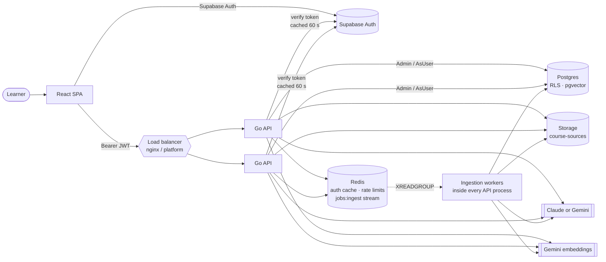

# Architecture

Adigam AI is a React single-page app, a stateless Go API, Postgres on Supabase (with row-level
security on every table), Redis, Supabase Storage and one AI provider (Claude or Gemini).

Related documents: [grounding](grounding.md) · [learner model](learner-model.md) · [API](api.md) ·
[database](database.md) · [security](security.md) · [deployment](deployment.md)

## Components

| Component | Where | Role |
|---|---|---|
| Web app | `frontend/` | React 19 + React Router 7 + Vite, TypeScript, plain CSS tokens (`src/styles/theme.css`). Signs in with Supabase Auth and calls the API with the access token. |
| API | `server/cmd/api` | Go `net/http` server. Mounts three route groups, starts the ingestion workers, serves `/api/v1/health` and `/api/v1/health/deep`. |
| Route groups | `server/internal/web/{learning,practice,content}` | HTTP handlers. Each package has a `routes()` table that `Register` mounts through `app.Deps.Authed`. |
| Engines | `internal/learner`, `adaptive`, `planning`, `assessment`, `readiness`, `goals`, `groups`, `curriculum` | Pure, deterministic Go. No database and no AI calls. |
| AI | `internal/ai` | `claude.go`, `gemini.go` (one interface, selected by `AI_PROVIDER`), `embed.go` (Gemini embeddings), `prompts.go`, `tutor.go` (grounded answering), `validate/` (checks on generated questions). |
| Extraction | `internal/sources` | PDF, PPTX, WebVTT/SRT and YouTube captions turned into located text. No model calls. |
| Data access | `internal/store`, `internal/db` | SQL for every table, written with pgx v5. `db.DB` provides `Admin` and `AsUser`. |
| Infrastructure | `internal/auth`, `ratelimit`, `shed`, `jobs`, `httpx`, `config` | Token verification, per-learner quotas, overload shedding, the Redis Streams queue, the response envelope, environment config. |
| Postgres | `database/migrations` | Supabase Postgres. RLS on every table, column-level grants, pgvector (migration 029). |
| Redis | — | Auth cache (`auth:<sha256(token)>`, 1 minute), rate-limit counters (`rl:<name>:<userId>`), the `jobs:ingest` stream, and question-generation locks (`qgen:<topicId>`). |
| Storage | Supabase bucket `course-sources` | Private bucket for original uploads. Files are reached only through signed links that last 1 hour. |



## Request flow

Middleware order for an authenticated route, from outside in (`cmd/api/main.go`, `app/app.go`):

1. **`cors`**: echoes `Origin` only when it is listed in `CORS_ORIGINS`, and answers `OPTIONS` with 204.
2. **`shed.Limit(MAX_IN_FLIGHT)`**: admits at most `MAX_IN_FLIGHT` requests at a time (default 256). See [Overload shedding](#overload-shedding).
3. **`ServeMux`**: Go 1.22+ method and path patterns. Every route lives under `/api/v1`.
4. **`auth.Require`**: reads `Authorization: Bearer <token>` (20–4096 characters) and checks it against Supabase `GET /auth/v1/user`. The resulting user id is cached in Redis under `auth:<sha256(token)>` for 1 minute. The user id comes only from the token; any id in a body or query is ignored.
5. **Rate limit** (on some routes only): `ratelimit.Limit` keeps a fixed one-hour window per verified user id. Over the limit it returns 429 `RATE_LIMITED`. If Redis is down it lets the request through.
6. **Handler** (`httpx.Handler`): returns an error, and `httpx.Wrap` turns it into the response envelope:

```json
{ "success": true,  "data": { ... }, "error": null }
{ "success": false, "data": null, "error": { "code": "INVALID_INPUT", "message": "..." } }
```

Errors that are not `*httpx.Error` are logged and returned as 500 `INTERNAL_ERROR`.

Server timeouts:

| Timeout | Value |
|---|---|
| Read header | 10 s |
| Read | 2 min |
| Write | 3 min |
| Idle | 2 min |
| Max header size | 64 KiB |
| Shutdown grace on SIGTERM | 10 s |

## Admin and AsUser: keeping RLS in force

`internal/db/db.go` exposes two ways to reach the database:

| Client | What it is | Used for |
|---|---|---|
| `DB.Admin` | The pgx pool, connected as the database owner. Bypasses RLS. | Work that needs it: grading against the answer key, and writing attempts, mastery, plans, goals, self-ratings and mistake patterns (tables where learners hold only `SELECT`). Reads that must see other learners' rows (groups). Every query filters by user id by hand. |
| `DB.AsUser(ctx, userID, fn)` | A transaction that runs `set_config('request.jwt.claims', '{"sub":…,"role":"authenticated"}', true)` and `set_config('role','authenticated', true)`, then calls `fn`. | Reads of the learner's own rows: goal, summary, activity, profile, readiness, revision, tutor history. RLS policies (`auth.uid() = user_id`) apply exactly as they would in the browser. |

Both settings are transaction-local (`true` = `LOCAL`), so they end with the transaction and never
leak to the next request that borrows the connection. With `AsUser`, a query that forgets its
`WHERE user_id = …` still cannot return another learner's rows.

Pool settings:

- `MaxConns` defaults to 12, to stay under the Supabase free session pooler's limit of 15. Override it with `?pool_max_conns=N`.
- `statement_timeout` is 15 s.
- With `DB_POOL_MODE=transaction`, pgx uses the simple protocol (no prepared statements), as transaction poolers require.

## Stateless scaling and the load balancer

API processes keep no state in memory: the auth cache, rate limits, the job queue and the
generation locks all live in Redis. Any instance can therefore serve any request, and capacity
grows by adding instances.

`deploy/nginx.conf` is a local example with three instances on `:4001–4003` and the balancer on `:4000`:

| Setting | Value | Why |
|---|---|---|
| `least_conn` | — | Long AI calls don't pile onto one instance. |
| `max_fails=3 fail_timeout=10s` | per upstream | An instance that fails is taken out of rotation. |
| `proxy_next_upstream` | `error timeout http_502 http_503` | Retries on another instance (nginx retries non-idempotent methods only if the request was not yet sent). |
| `client_max_body_size` | 41m | Allows the 40 MB upload limit. |
| `proxy_read_timeout` | 180s | AI answers can take up to 90 s. |
| `keepalive` | 256 | Reuses upstream connections. |

On a managed host, the platform's balancer replaces this file. Once instances × pool size exceeds
about 15 connections, run every instance with `DB_POOL_MODE=transaction` against the Supabase
transaction pooler (`:6543`).

## Overload shedding

`internal/shed` caps the requests in flight per instance (`MAX_IN_FLIGHT`, default 256):

- A request waits up to `queueWait` = 250 ms for a slot.
- If no slot frees up, it gets `503 SERVER_BUSY` with `Retry-After: 2`.
- Paths starting with `/api/v1/health`, and every `OPTIONS` request, are never shed, so a balancer can still tell a busy instance from a dead one.

On the client, `frontend/src/lib/api.ts` retries a failed GET up to twice, with jittered backoff of ±50% around 700 ms × attempt. POSTs are never retried, because a repeated attempt would be recorded as a second try at the question.

## Ingestion queue lifecycle

Uploads are processed by `internal/jobs`, a durable queue on Redis Streams. Each API process also runs
workers (`content.StartWorkers`).

```mermaid
sequenceDiagram
    participant C as Client
    participant API as API (handler)
    participant S as Storage
    participant DB as Postgres
    participant Q as Redis stream jobs:ingest
    participant W as Worker (any instance)
    C->>API: POST /sources/upload (or /video, /video/captions)
    API->>S: store original file (uploads)
    API->>DB: insert course_sources (status = processing)
    API->>Q: XADD {sourceId…}
    API-->>C: 202 {source: {id, status: processing}}
    W->>Q: XAUTOCLAIM idle > 10 min, else XREADGROUP (block ≤ 5 s)
    W->>DB: delete old chunks, extract, describe figures, embed, insert chunks
    W->>DB: status = ready
    W->>Q: XACK + XDEL
    Note over W,Q: on error: left pending, reclaimed after 10 min;<br/>after 3 deliveries OnGiveUp marks the source failed and acks
```

| Property | Value |
|---|---|
| Stream / consumer group | `jobs:ingest` / `workers` |
| Consumer name | `<hostname>-<pid>` |
| Visibility timeout | 10 min. A job not acknowledged in that time is reclaimed by `XAUTOCLAIM`. |
| Max attempts | 3 deliveries. Then `OnGiveUp` sets the source to `failed`, and the entry is acknowledged and deleted. |
| Delivery semantics | At least once. The handler is idempotent: re-running a source deletes its old chunks before inserting new ones. |
| Orphans | On start, `recoverOrphans` re-queues sources still `processing` after 1 min that have no entry in the stream. |
| Shutdown | Workers stop when the server's context is cancelled. Unacknowledged jobs stay pending for the next worker. |

What a job does for each format is described in [grounding.md](grounding.md#ingestion).

## AI provider

`ai.New(cfg.AISettings())` returns one client for either provider. Callers ask for a **quality** level, not a model:

| Quality | Claude default | Gemini default | Used for |
|---|---|---|---|
| `High` | `claude-opus-5-5` | `gemini-3.5-flash` | Output that becomes stored data: generated questions, answer checks, course maps, curricula. |
| `Standard` | `claude-sonnet-5-5` | `gemini-3.5-flash-lite` | Output a person reads and judges: tutor answers, translation, rubric grading, flashcards, figure descriptions. |

- `AI_MODEL_HIGH` and `AI_MODEL_STANDARD` override the defaults.
- Claude: structured outputs use `output_config.format` with a JSON Schema. A refusal is detected through `stop_reason`, and server-side fallbacks re-run a declined request on another model.
- Gemini: when the High model is busy, the call falls back to the Standard model.
- Without a key for the selected provider, `Deps.AI` is nil and AI routes answer 503 `AI_UNAVAILABLE`. Everything else keeps working.
- Embeddings always come from Gemini (`gemini-embedding-2`, 768 dimensions) when `GEMINI_API_KEY` is set. Without it, retrieval falls back to words only.

## Design rules

- **Arithmetic in Go, language in the model.** Mastery, scheduling, difficulty, recommendations, plans, readiness and grading of choice and numeric answers are deterministic Go with unit tests. The model reads material, writes and checks questions, grades free-text answers against a rubric, and explains.
- **Security in the database.** RLS and column grants are the boundary, not only API checks. See [security.md](security.md).
- **The attempt log is the source of truth.** Mastery is recomputed from `question_attempts` after every answer, never nudged in place.
